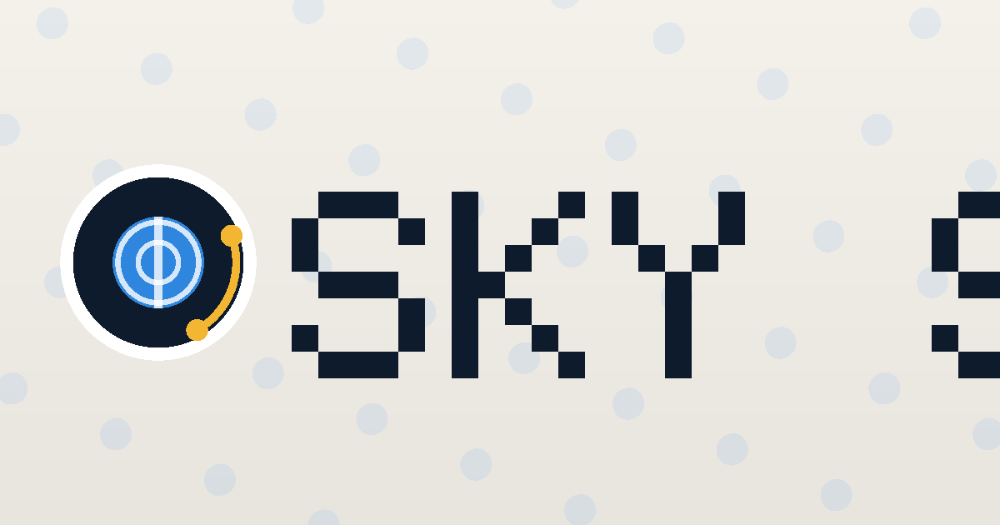

# SKYGUESSR — Find the Route ✈️

A daily flight-route deduction game, reverse-engineered and rebuilt from a reference video.
Guess the secret origin → destination airport pair in 5 tries using great-circle distance +
direction feedback, with clues drip-fed as you spend guesses.



## The game

- Each day, 3 routes are seeded deterministically from the date: **Easy**, **Medium**, **Hard**.
  Everyone playing that day gets the same routes.
- Guess a route with a fast airport autocomplete (IATA code, city, or name).
- Every wrong airport you place shows its **distance** to the hidden airport on that side.
- Each guess unlocks a clue, in order: **duration → aircraft → domestic/international →
  direction → airline**, and the **route map** appears when the game ends.
- Stuck? 💡 hints (earned by watching a rewarded ad, one per side per game) reveal an airport
  at a score cost.
- Share a spoiler-free emoji grid, track streaks, stats and past routes.

## Repository layout

```
skyq/
├── index.html            # the game (web)
├── css/styles.css        # aviation-paper design system
├── js/
│   ├── data.js           # ~260 airports, 100+ airlines, 42 aircraft
│   ├── engine.js         # pure game logic (shared by web, tests, iOS)
│   ├── app.js            # UI controller
│   └── ads.js            # monetization layer (AdSense / AdMob / rewarded / IAP)
├── tools/                # icon gen, tests, bundlers, ipa script
├── ios/App               # Capacitor 7 iOS project (Swift Package Manager)
├── manifest.webmanifest  # PWA manifest
├── sw.js                 # service worker (offline play)
└── skyq-standalone.html  # single-file build (share/review copy)
```

## Quick start (web)

```bash
cd skyq
python3 -m http.server 8000        # or any static server
# open http://localhost:8000
```

Or open `skyq-standalone.html` directly — it's fully self-contained.

## Tests

```bash
npm test        # 13 engine tests: seeds, geo math, clue gates, hints, streaks
```

## iOS (.ipa)

The iOS wrapper is Capacitor 7 with **Swift Package Manager** (no CocoaPods needed).

```bash
npm install
npx cap sync ios                       # copies www/ into the native project
open ios/App/App.xcodeproj             # resolve packages, set your Team
bash tools/build-ipa.sh simulator      # sanity build
bash tools/build-ipa.sh                # archive + export App Store .ipa
```

Full store checklist: see `APPSTORE.md`. Monetization setup: see `MONETIZATION.md`.

## Design decisions worth knowing

- **Determinism**: puzzles come from a seeded PRNG (xmur3+sfc32) keyed on the date —
  no server required, everyone gets identical routes, and past days can be regenerated
  for an archive.
- **The engine is pure**: `js/engine.js` has zero DOM access, so the same file runs the
  website, the node test suite, and the iOS app.
- **Great-circle math** (haversine + initial bearing) gives real aviation feedback;
  aircraft are chosen so their range plausibly covers the route, and durations are
  simulated from cruise speed.
